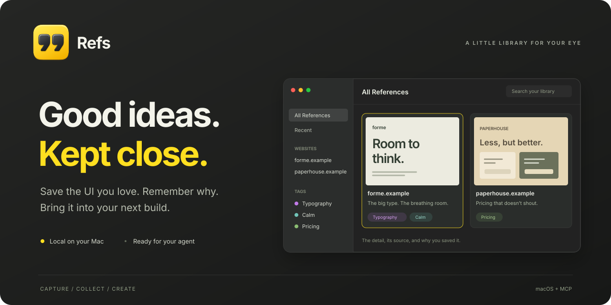

<p align="center">
  
</p>

<p align="center">
  A little macOS app for the details that become your next idea.<br />
  Save screenshots and videos with their source and a note. Bring them into your next build with MCP.
</p>

<p align="center">
  <a href="https://refsapp.pages.dev"><strong>Explore Refs ↗</strong></a>
  &nbsp; · &nbsp;
  <a href="#get-started">Get started</a>
  &nbsp; · &nbsp;
  <a href="#bring-your-references-to-your-agent">Connect your agent</a>
  &nbsp; · &nbsp;
  <a href="docs/development.md">Build from source</a>
</p>

<p align="center"><sub>macOS 14+ &nbsp; · &nbsp; Apple Silicon &nbsp; · &nbsp; Local files &nbsp; · &nbsp; MCP</sub></p>

## Keep the thing. And the thought.

A good layout, a quiet color palette, a small interaction that feels right. Refs keeps the UI you notice together with where it came from and what you liked about it.

| Capture the detail | Keep the context | Use it again |
| --- | --- | --- |
| Grab an area or window. Record a silent video when the motion matters. | Refs saves the app or website. Add one line about what caught your eye. | Find it by source, note, or tag. Let your coding agent read it through MCP. |

### A library that feels like you

- **Images and motion together.** Keep screenshots and screen recordings in one searchable library.
- **Sources remembered.** Browse by app or website and return to the original URL when available.
- **Tags for the threads you collect.** Group typography, pricing pages, interactions, or whatever you keep noticing. Tag several references at once.
- **A home on your Mac.** Your library is a folder of media and JSON files. Choose its location in Settings.
- **Context for your next build.** Give your coding agent the reference, its source, and your note through MCP.

## Get started

Download the [latest DMG](https://github.com/iipanda/refs/releases/latest/download/Refs-macOS.dmg). You can also [build Refs from source](docs/development.md).

1. Open the DMG, drag **Refs** into **Applications** and open it.
2. Follow setup to allow **Screen Recording**, then quit and reopen Refs. Allow browser **Automation** to save website URLs and titles.
3. Capture something, add what you like about it, and press **Return**.

| Action | Shortcut or control |
| --- | --- |
| Capture an area | **⌘⇧2** |
| Capture a window | **⌘⇧3** |
| Switch area ↔ window while selecting | **Space** |
| Record a video | **Record Area…** or **Record Window…** in the menu bar |
| Cancel a capture | **Esc** |

Shortcuts are configurable. If **⌘⇧3** takes a full-screen screenshot instead, change that shortcut in macOS or Refs.

[More about capture, permissions, tags, and storage →](docs/usage.md)

## Bring your references to your agent

Open **Refs → Settings → Agents** and copy the setup prompt into your coding agent. Manual instructions are included for Claude Code, Codex, Cursor, Claude Desktop, Pi, and Oh My Pi.

For Claude Code:

```sh
claude mcp add --scope user refs -- /Applications/Refs.app/Contents/MacOS/refs-mcp
```

Then ask for something concrete:

> Find my references tagged “Typography” and use their spacing and type hierarchy as a starting point for this page.

The bundled MCP helper can search and read references, import local media, edit notes, manage tags, and move items into or out of Trash. It works even when the app is closed.

[MCP tools and examples →](docs/mcp.md)

## Build from source

Requires **macOS 14+**, **Apple Silicon**, and **Xcode 26+** with its Swift toolchain and Icon Composer compiler.

```sh
swift test
./scripts/build-app.sh
open build/Refs.app
```

[Build, signing, icon sources, and repository layout →](docs/development.md)

## License

Refs is licensed under the [GNU Affero General Public License v3.0](LICENSE) (`AGPL-3.0-only`).
Third-party components and assets retain their respective licenses and notices.

---

<p align="center">
  <strong>Save the UI you love. Remember why.</strong><br />
  <a href="https://refsapp.pages.dev">Take a look at Refs ↗</a>
</p>
